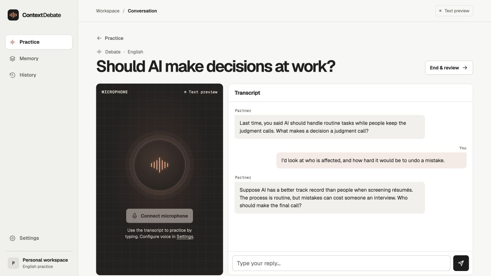
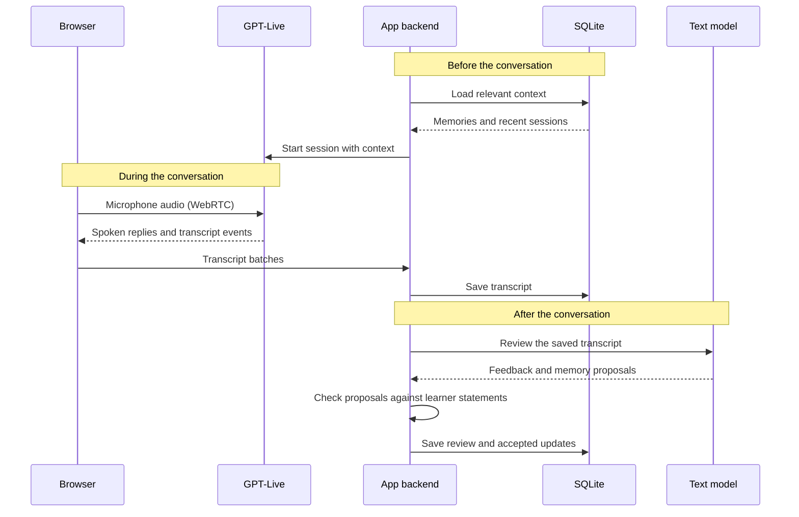

# Context Debate

**An English voice partner that picks up where you left off.** Talk through an idea in Explore mode or defend a position in Debate mode. Your partner can carry forward your interests, views, and feedback preferences from earlier sessions.



*The debate workspace in text preview, populated with sample dialogue.*

## How a conversation carries forward

1. **Setup interview.** Tell your partner what you want to practice, what you care about, and when you want English feedback.
2. **Debate.** Suppose you said that AI should handle routine work while people keep the judgment calls. A later session can ask, “If AI is better at screening résumés, who should make the final call?”
3. **Review.** Read a summary, get English phrasing suggestions, and take an open question into the next discussion. You can inspect, edit, or forget the memories that shape future sessions.

## How voice and memory connect



Each saved memory links to the learner’s words. Forgetting a memory keeps it out of future context and preserves the transcript in History. [Architecture and memory rules](docs/architecture.md)

Live audio and relevant context go to OpenAI when voice is enabled. The single-user workspace stores transcripts locally.

## Run locally

Requires **Node.js 22.16 or newer**. The application has no npm runtime dependencies.

```sh
cp .env.example .env
npm start
```

Open [http://localhost:3000](http://localhost:3000). Add your own `OPENAI_API_KEY` to `.env` and restart to enable live voice, model-generated typed turns, and AI reviews. OpenAI API usage is billed to the API project. Without a key, a scripted text preview exercises the workspace and session flow.

| Setting | Default or purpose |
| --- | --- |
| `OPENAI_VOICE_MODEL` | `gpt-live-1` |
| `OPENAI_TEXT_MODEL` | `gpt-6-luna` for typed replies and review |
| `OPENAI_VOICE` | `marin` |
| `HOST`, `PORT` | `127.0.0.1`, `3000` |
| `DB_PATH` | `./data/context-debate.sqlite` |
| `APP_USERNAME` | `owner` |
| `APP_PASSWORD` | At least 16 characters for a production or non-loopback bind |
| `APP_ORIGIN` | Complete external origin, such as `https://debate.example.com`, when using a proxy |

## Run in Docker

Set `APP_PASSWORD` and `OPENAI_API_KEY` in `.env`, then start the service.

```sh
docker compose up --build -d
docker compose ps
```

Compose binds to localhost and stores the database in the `debate-data` volume. For a remote deployment, point an HTTPS reverse proxy at that port and set `APP_ORIGIN` to the external HTTPS origin. Serve over HTTPS outside localhost so browsers can access the microphone. Keep the application port behind the proxy and run one replica per workspace.

Back up the SQLite database before replacing the host or removing the named volume. For a simple filesystem backup, stop the app and preserve the data directory, including SQLite sidecar files if present.

## Verification

```sh
npm test
```

Tests cover the HTTP session lifecycle, memory decisions, transcript replay, and provider requests with mocked transport. GitHub Actions also builds the container and checks startup and authentication.

OpenAI Docs cover the [live voice connection](https://developers.openai.com/api/docs/guides/live), [transcript events](https://developers.openai.com/api/docs/guides/live-conversations), and [model pricing](https://developers.openai.com/api/docs/models/gpt-live-1).
